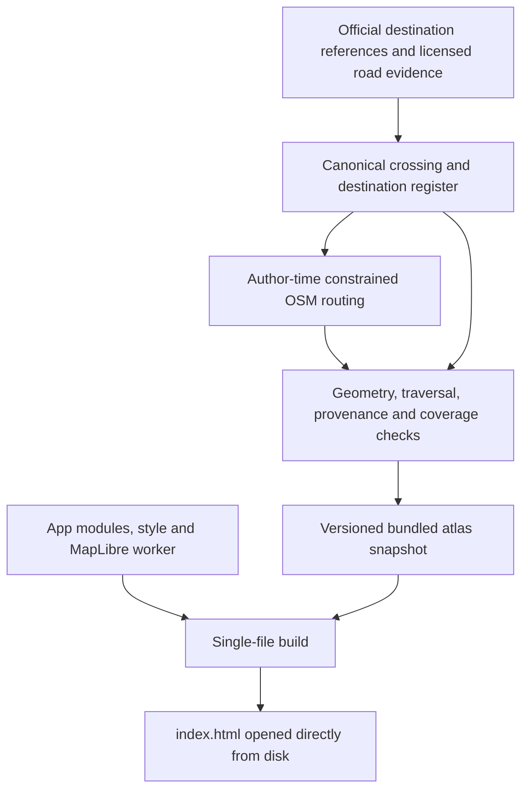
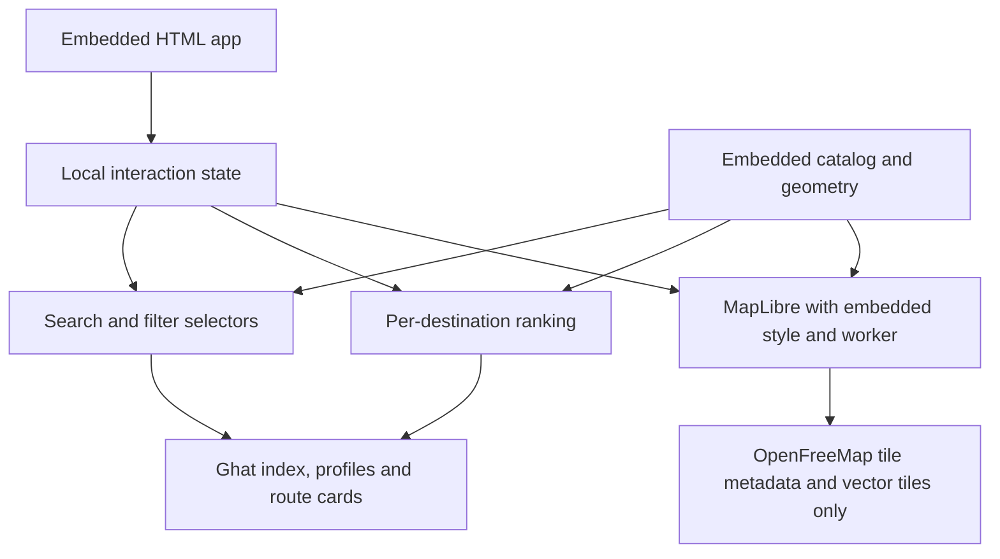
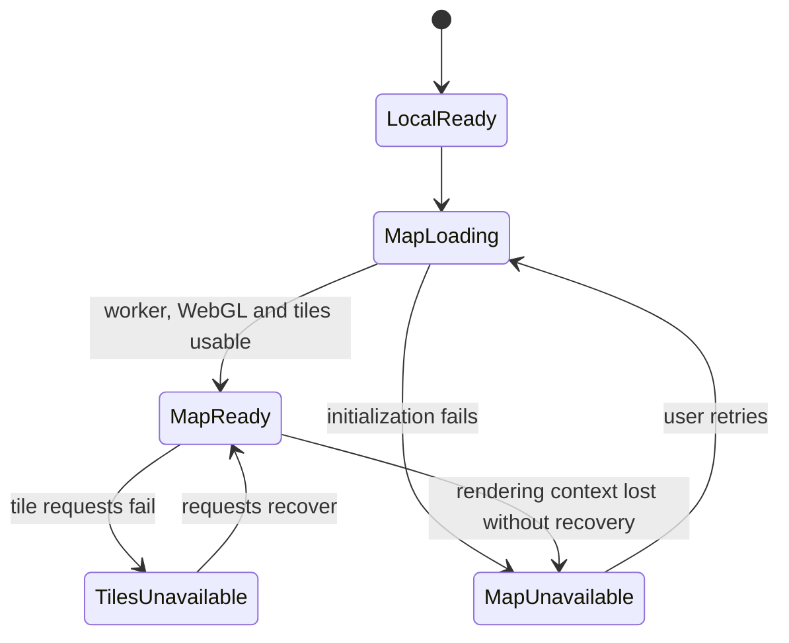
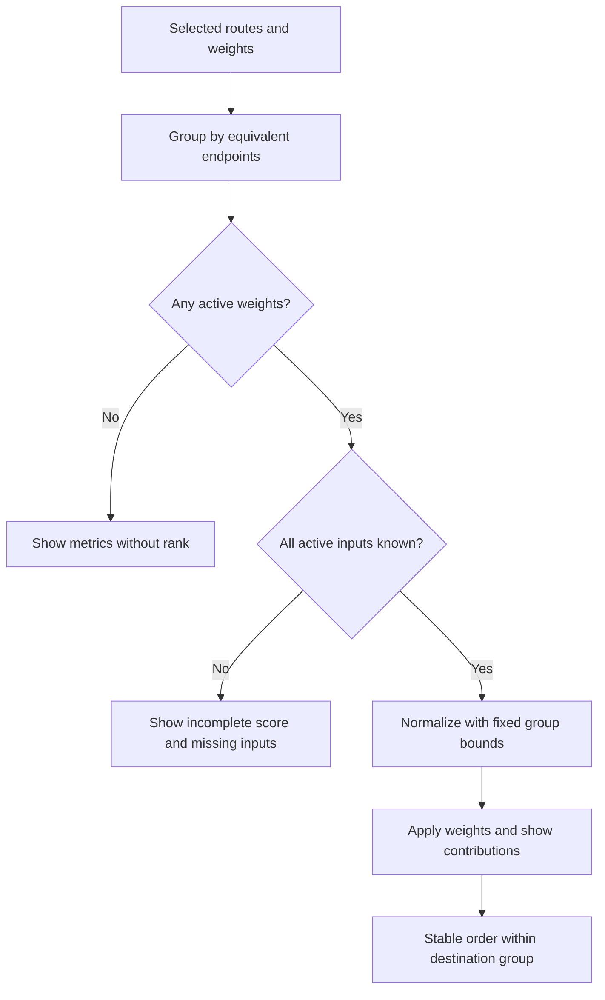

# feat: Build the Pune Konkan ghat and beach atlas

## Summary

Build a premium desktop, ghat-first atlas for understanding and comparing journeys from Pune to curated Maharashtra Konkan and Goa beaches. Deliver one double-clickable HTML file with researched routes, local search, personal ranking weights, and a keyless online basemap.

This document preserves the completed scope sweep and the implementation plan together. Application implementation has not started.

---

## Scope Sweep Summary

**Topic:** Understand the mountain crossings, route alternatives, distances, and important waypoints between Pune and Konkan beaches, extending into Goa.

**Skill and mode:** pp-scope-sweep1; one-by-one.

**Preset:** Design + code-change.

**Grounding:** The working directory was empty when inspected. There was no existing app, route catalog, dependency manifest, test suite, or hosting configuration to follow. This is greenfield work, not an extension of an existing codebase.

### Final Coverage Map

| Dimension | Status | Captured decision | Open sub-questions |
|---|---|---|---|
| Geographic coverage | covered | Curated famous beaches; ghat-first inventory of documented public car-drivable crossings relevant to Pune-Konkan trips, including crossings into Goa and selected Goa beaches | Research must establish the actual inventory |
| Route alternatives | covered | Curated routes through relevant ghats, plus practical highway alternatives | None |
| Meaning of best | covered | Adjustable personal weights for route ranking | Technical scoring semantics below |
| Data and freshness | covered | Bundled researched snapshot; road-following geometry, sourced distances, approximate times, dated references, labeled editorial attributes | Actual sources and measurements to collect |
| Ghat details and waypoints | covered | Balanced profiles: length, elevation where available, driving character, scenery, seasonality, junctions, towns, viewpoints | Unsupported attributes stay unknown |
| Map and comparison | covered | Ghat-first strongly primary; map-first overview secondary; routes independently and together | None |
| Search | covered | Unified place/route search; distance, time, ghat, difficulty, scenery filters | None |
| Static/offline architecture | covered | One self-contained HTML opened by double-click; internet for basemap delivery only | Direct-file compatibility requires implementation verification |
| Experience and accessibility | covered | Premium travel atlas, rich cards, restrained motion; desktop only; no mobile support | None |
| Completion and validation | covered | Complete researched atlas across the agreed geography, working interactions, desktop browser verification | Inventory-relative completeness must be evidenced |

### Answer Record and Clarifications

| Question | User answer | Recorded interpretation |
|---|---|---|
| Geographic coverage | "1 + 5 - make sure to cover all ghats that go upto goa." | Curated famous beaches plus systematic ghat-first coverage |
| Route alternatives | "1" | Curated ghat routes plus practical highway alternatives |
| Meaning of best | "3" | Adjustable personal weights |
| Data and freshness | "1" | Researched bundled snapshot |
| Ghat profiles | "1" | Balanced geography, driving, scenery, and waypoint information |
| Primary interaction, initial | "8 + 1 where 8 >> 1" | Initially ambiguous; not silently interpreted |
| Search | "1" | Unified search and structured filters |
| Packaging | "2" | Self-contained double-click HTML; online basemap only |
| Experience | "1 + I do not need mobile support at all. Target desktop only." | Premium atlas, explicitly desktop only |
| Completion standard | "1" | Complete usable atlas, not sample-data prototype |
| Geographic clarification | "2" | Include routes entering Goa and selected Goa beaches |
| Workflow clarification | "2" | Ghat-first atlas strongly preferred; map-first secondary |
| Completion check | "yes" | Scope sweep accepted |
| Planning direction | "Yes, proceed to planning. Use google maps for tiles etc." | Initially requested Google Maps |
| Provider/packaging conflict | "Keep double-click HTML and avoid Google billing/key setup - reconsider the basemap provider" | Supersedes Google preference; preserve direct-file/no-key/no-billing constraints |
| Persistence | "save the scope sweep and the plan to a file in this dir. then proceed" | Save this combined document in the working-directory root and continue planning |

The final provider answer is authoritative: do not introduce Google Maps, billing setup, or API keys unless the user changes that decision.

### Key Ramifications

- Comprehensive ghat coverage is a data-research obligation, not a claim satisfied by plotting a handful of famous passes.
- Every crossing needs a canonical identity, aliases, evidence, and links to appropriate beach itineraries. The scope does not require every ghat to connect to every beach.
- Route distances and times need consistent endpoints; rankings must distinguish measurements from estimates and editorial judgments.
- Ghat-first discovery must work before a beach is selected. Individual focus and combined route viewing remain available.
- Single-file packaging means app scripts, styles, data, and worker dependencies cannot depend on a server or runtime CDN.
- No skipped dimensions remain. Unknown source coverage and direct-file feasibility are explicit implementation gates, not silently waived requirements.

### Unresolved Unknowns at Scope Completion

| Unknown | Risk | Why it matters |
|---|---|---|
| Complete crossing inventory and aliases | High | A selective catalog must not masquerade as exhaustive |
| Reusable geometry and supported scoring inputs | High | Fabricated paths or unsupported scores would undermine the product |
| Pune origin and estimate assumptions | Medium | Endpoint differences invalidate comparisons |
| Keyless provider and direct-file behavior | Medium | The delivery constraint must work without browser-security workarounds |
| Exact beach catalog and default weights | Medium | Require explicit curation within the agreed scope |

**Recommended next action at exit:** Planning, including source/inventory research and direct-file mapping feasibility. The user approved proceeding.

---

## Problem Frame

A traveler choosing a beach from Pune needs to understand the mountain crossing as well as the destination. An origin/destination map alone conceals the geography, driving character, junction choices, and tradeoffs between corridors. The atlas should make those tradeoffs legible without pretending to provide live navigation or current road availability.

The catalog must cover documented public car-drivable crossings relevant to these journeys, south through Goa. "All" is evaluated against an explicit, dated research baseline and inclusion/exclusion register, not an unsupported assertion of universal completeness.

---

## Requirements

### Geographic Data and Trust

- R1. Maintain a source-backed inventory of eligible ghats, canonical names, aliases, inclusion/exclusion rationale, and research cutoff. Include relevant Goa crossings and curated Maharashtra/Goa beaches.
- R2. Provide a Pune-to-beach itinerary through each included ghat where research supports a public car-drivable route, plus practical highway alternatives. Distinguish unresolved access from confirmed eligibility; unresolved candidates cannot silently disappear from the completeness register.
- R3. Use genuine road-following geometry, consistent endpoints, sourced route distances, approximate journey times, and ordered important waypoints. Do not represent straight waypoint joins as routed roads.
- R4. Provide balanced ghat profiles with length, elevation where available, driving character, scenery, seasonal caveats, junctions, towns, and viewpoints. Distinguish source date, retrieval date, and verification date.
- R5. Bundle the researched snapshot, source references, methodology, license notices, and unknown-value labels. Do not imply live traffic, road condition, or closure coverage.

### Exploration and Decision Support

- R6. Make ghat-first browsing the primary entry, with a secondary map overview, pan/zoom, fit-route/fit-selection, independent route focus, and simultaneous route visibility.
- R7. Provide unified local search across ghats, beaches, towns, viewpoints, and routes, with canonical alias handling and distance/time/ghat/difficulty/scenery filters.
- R8. Let users adjust weights for time, distance, scenery, driving difficulty, and tolls. Explain score contributions and unknown inputs; compare rankings only for equivalent origin/destination endpoints.
- R9. Keep filters, focus, selected route overlays, search results, and comparisons synchronized and understandable, including empty results and selected-but-filtered routes.

### Delivery and Experience

- R10. Ship `index.html` as one self-contained artifact opened directly from disk. No end-user backend, build step, account, API key, billing, or externally loaded application code is required. Internet use is limited to permitted basemap tiles and tile-source discovery metadata.
- R11. Provide a premium desktop-only atlas, keyboard-operable controls, readable contrast, reduced-motion handling, and text-based access to route details. Include a sticky, independently scrollable index generated from every document heading, including collapsed panels; opening a heading link reveals its content. This carries the user's existing HTML-artifact preference.
- R12. Verify the complete catalog and interactions on supported desktop browsers under actual direct-file loading, including network/provider failure. Do not substitute localhost success for this acceptance criterion.

---

## Key Technical Decisions

- KTD1. **MapLibre GL JS with OpenFreeMap is the planned basemap stack, conditional on a direct-file gate.** OpenFreeMap documents keyless public vector tiles, MapLibre integration, and required attribution [S1-S3]. This fits the revised provider constraint better than Google. Compatibility is not established by documentation alone. Public service availability is best effort, not an application guarantee.
- KTD2. **Embed a minimal custom map style and use local font rendering.** Omit a remote glyph URL; MapLibre documents local font rendering when glyphs are omitted [S5]. Use simple embedded icons or rendered geometric markers rather than remote sprite sheets. Allow only OpenFreeMap tile metadata and tile requests at runtime; no remote style, script, font, geocoding, routing, elevation, or analytics calls. Verify readable Latin labels and relevant place names before adopting this style.
- KTD3. **Separate authoring files from the single deliverable.** Maintain small JavaScript modules, data, tests, and an author-time bundler; inline the resulting app, CSS, worker bundle, and validated data into root `index.html`. The recipient needs only that file. Pin dependency versions during implementation and preserve licenses. The current MapLibre documentation describes ESM and an explicit worker bundle [S4]; build the worker into a self-contained Blob URL rather than assuming old global-script behavior.
- KTD4. **Research the inventory before producing the full route bundle.** Build a crossing register from geographical/road evidence and official destination references, reconcile aliases, and track rejected and unresolved candidates. Tourism pages are discovery and descriptive sources, not proof of precise geometry, current access, or exhaustive coverage [S8-S9]. No fixed ghat/beach count is invented at planning time.
- KTD5. **Generate geometry at author time using OSM-based routing.** Use a controlled OSRM instance with a region extract and driving profile, or an explicitly permitted export service whose persistence and redistribution rights are checked first. Do not assume a public demo endpoint is a bulk-generation service. OSRM supports ordered routing coordinates and full GeoJSON geometry; returned alternatives are not guaranteed [S6]. Never copy Google geometry or estimates into the bundle.
- KTD6. **Validate named-ghat traversal, not just endpoint routing.** Constrain generation through surveyed entry, interior, and exit anchors; validate their order and the actual road corridor. Store waypoint positions along the geometry and identify which stops are on-route versus nearby optional detours. Reject bypasses, ferry-only links without an explicitly modeled alternative, broken segments, and unsourced synthetic paths.
- KTD7. **Adopt a disclosed common Pune reference point and beach arrival points.** Use one centrally located, car-accessible Pune start selected and verified during research; show its name and coordinates. Freeze endpoints per destination. Driving time is a model estimate excluding unmodeled stops/traffic; disclose routing profile and snapshot date. Do not infer time solely by dividing distance by a generic speed.
- KTD8. **Rank only like-for-like journeys.** Use fixed per-destination normalization bounds from the complete bundled alternatives, independent of filters. Lower time/distance/difficulty/tolls and higher scenery are favorable. Constant metrics contribute equally and do not divide by zero. Normalize nonzero user weights; all-zero weights disable ranking. Unknown active metrics make a route score incomplete and place it outside the fully scored order, with missing criteria shown; never replace unknown with zero, a favorable mean, or hidden per-route reweighting. Cross-destination selections remain inspectable but are grouped and not assigned one global winner.
- KTD9. **Keep editorial rubrics explicit.** Difficulty and scenery use short documented ordinal rubrics with supporting notes, not an implied objective safety rating. Unsupported toll/elevation values remain unknown; availability of those attributes is not fabricated to make scoring look complete. Default equal weights are an implementation default, not a user-stated preference.
- KTD10. **Use one explicit local state model.** Distinguish focused ghat/beach, query, filters, selected routes, hovered route, and weights. Focus changes do not silently delete selections. Show selected-but-filtered routes with reveal/remove actions, clear stale hover, and keep fit-selection explicit. Alias search resolves to canonical IDs. Refresh resets session state unless persistence is later requested; localStorage is not a requirement.
- KTD11. **Design for graceful loss of map service.** Bundled profiles, search, itinerary text, and ranking do not depend on basemap success. Tile failure leaves route overlays where rendering is available; map initialization/WebGL failure presents a clear unavailable state alongside accessible route information. This is degraded behavior, not a claim of fully offline map support.

---

## High-Level Technical Design

### Author-Time Data and Artifact Flow



### Runtime Components and Network Boundary



### Map Availability Lifecycle



Local search, profiles, and comparisons remain available in each state after `LocalReady`.

### Ranking Decision Flow



---

## Data Contract and Research Standard

| Entity | Essential content | Integrity rule |
|---|---|---|
| Origin | Canonical Pune point, name, coordinates | Identical origin for comparable routes |
| Ghat | ID, aliases, anchors, profile, access evidence, references | One crossing identity despite alternate names |
| Beach | ID, aliases, region, arrival point, descriptive references | Comparable alternatives share an arrival point |
| Waypoint | ID, kind, coordinates, references | Distinguish junction, stop, viewpoint, and optional detour |
| Route | Endpoint IDs, ordered ghat IDs/waypoints, geometry, distance, time, metrics, provenance | Road-following route actually traverses its labeled crossings |
| Source | Reference URL/title, source/retrieval/verification dates, claim association, permission/license | A citation supports the specific recorded claim |
| Snapshot | Version, cutoff, origin, rubrics, normalization bounds, generator/profile metadata | Rebuildable data, no silent runtime refresh |
| Coverage register | Candidate ID, inclusion state, rationale, evidence, linked routes | Included and unresolved candidates accounted for |

Keep distance in meters and duration in seconds internally; format kilometers/hours for display. Store unknowns explicitly, not as empty strings or zero. Differentiate full-trip distance, ghat-section length, elevation above sea level, and elevation gain.

For completeness, cross-check at least two independent discovery sources where available and audit the road network for intervening crossings. Maintain a north-to-south coverage review with aliases and excluded/unresolved candidates. A single road graph or tourism list does not prove completeness.

Every included ghat needs at least one validated itinerary to an appropriate curated beach, or an explicit unresolved gap that blocks a claim of complete delivery. No arbitrary maximum detour is silently introduced; document relevance decisions and surface borderline cases before excluding them.

Track OSM-derived data separately from original editorial text, preserve required attribution, and provide the applicable ODbL notice and distributable source data [S7]. Summarize source descriptions in original words rather than copying tourism pages. Map provider tiles are not the route database.

---

## Output Structure

Paths are relative to the current workspace. The combined scope/plan stays at the root as requested; only `index.html` is required by the end user.

```text
2026-11-10-001-feat-konkan-ghat-atlas-plan.md
index.html
package.json
package-lock.json
src\
  index.template.html
  main.js
  state.js
  search.js
  ranking.js
  map.js
  ui.js
  styles.css
  map-style.json
data\
  atlas.json
  coverage-register.json
  sources.json
  atlas.schema.json
tools\
  build.mjs
  prepare-routes.mjs
  validate-data.mjs
tests\
  packaging.test.mjs
  data.test.mjs
  state-search.test.mjs
  ranking.test.mjs
  atlas.browser.spec.mjs
THIRD-PARTY-NOTICES.txt
DATA-LICENSE.txt
```

Use plain JavaScript with author-time esbuild, schema validation, Node's built-in unit test runner, and Playwright for desktop browser acceptance. There is no existing tooling to preserve; these dependencies are proposed for implementation, not installed during planning.

---

## Implementation Units

### U1. Prove Direct-File Mapping and Single-File Packaging

**Goal:** Establish that the hard delivery constraint works before investing in the full app.

**Requirements:** R6, R10-R12.

**Dependencies:** None.

**Files:** `package.json`, `package-lock.json`, `tools\build.mjs`, `src\index.template.html`, `src\main.js`, `src\map.js`, `src\map-style.json`, `tests\packaging.test.mjs`, `tests\atlas.browser.spec.mjs`, `THIRD-PARTY-NOTICES.txt`; generated `index.html`.

**Approach:** Pin a supported MapLibre version; inline app/CSS, ESM-derived worker bundle, minimal style, and one representative openly licensed route fixture. Embed GeoJSON as data, not a local fetch. Omit remote glyphs/sprites; use local fonts and embedded markers. Keep the fixture in the test suite or replace it with researched data later, not in the final catalog. Allow only provider tile-source metadata and tiles. Do not disable browser security, rely on extensions, or quietly switch to localhost.

**Patterns to follow:** Official MapLibre worker/bundling and local-glyph documentation [S4-S5]; OpenFreeMap attribution and integration [S1-S3]. No local precedent exists.

**Test scenarios:**
1. Covers AE5. Copy the generated HTML to another directory and open it directly in installed Edge/Chrome: pan, zoom, labels, and a route render with no sibling files.
2. Record all requests: no remote JS/CSS/fonts/styles, no local fetch, no API key, and no non-basemap service requests occur.
3. Covers AE6. Block provider requests: local content works and failures do not leave endless loading or erase the route state.
4. Simulate worker or WebGL initialization failure: visible map-unavailable state, route text still usable, retry does not duplicate listeners.
5. Confirm attribution remains visible at intended desktop viewport sizes.

**Verification:** A direct-file feasibility result identifies browser versions and allowed request classes. If this stack fails, investigate another keyless provider/renderer within the same constraints; if none works, return the actual blocker for a user decision rather than relaxing R10.

### U2. Establish the Researched Catalog and Validated Geometry

**Goal:** Produce the complete agreed data snapshot and evidence for inventory coverage.

**Requirements:** R1-R5.

**Dependencies:** None for research; complete U1 before committing to map-specific output optimization.

**Files:** `data\atlas.json`, `data\coverage-register.json`, `data\sources.json`, `data\atlas.schema.json`, `tools\prepare-routes.mjs`, `tools\validate-data.mjs`, `tests\data.test.mjs`, `DATA-LICENSE.txt`.

**Approach:** Reconcile the crossing inventory, select beaches representing the included corridors, and define the common Pune origin. Generate constrained itineraries and highway alternatives from reusable road data. Validate coordinate order, endpoints, anchor traversal, full-trip metrics, ghat-section metrics, reference claims, and access uncertainty. Preserve route generation settings and source snapshot identity so the bundle can be regenerated. Track failures as gaps, never replace them with a hand-drawn "route."

**Patterns to follow:** OSRM's ordered coordinates/full geometry contract [S6]; OSM data provenance [S7]; official tourism sources for original descriptive research [S8-S9].

**Test scenarios:**
1. Duplicate IDs or an alias mapping to two different crossings fails validation; legitimate alternate names resolve to one canonical crossing.
2. An included ghat without a verified route, geometry source, or required permission is a release-blocking gap.
3. Covers AE7. A route reaching its beach but bypassing the ghat interior anchor fails traversal validation.
4. Swapped coordinates, discontinuities, endpoint drift, out-of-order waypoints, and implausible metric/geometry discrepancies are flagged with the route ID.
5. Zero-valued unknown tolls/elevation and unsupported current-open claims fail the data rules; genuine known zero remains representable.
6. Every route uses the declared origin/destination endpoint and links to existing ghats/places/sources.
7. Source dates, verification dates, permissions, and northern/southern coverage reviews survive artifact generation.

**Verification:** Automated integrity checks pass and a map-based manual audit confirms every included ghat's traversal and corresponding itinerary. Publish the dated coverage register; do not declare completeness while material candidates remain unresolved.

### U3. Implement Local State, Search, Filters, and Personal Ranking

**Goal:** Provide deterministic exploration and defensible comparisons independently of the map.

**Requirements:** R7-R9.

**Dependencies:** U2 data contract; implementation may use retained, representative test fixtures before the entire catalog is finished.

**Files:** `src\state.js`, `src\search.js`, `src\ranking.js`, `tests\state-search.test.mjs`, `tests\ranking.test.mjs`.

**Approach:** Pure state/selectors for query, focus, filters, overlay selections, and weights. Normalize aliases and case/diacritics without inventing natural-language search. Use explicit supported numeric units. Keep matching results separate from selected overlays. Apply documented group-specific score normalization and missing-value handling; stable ID ordering resolves exact ties.

**Patterns to follow:** KTD8-KTD10 and the versioned data contract, rather than framework-specific global state.

**Test scenarios:**
1. A ghat alias, beach name, and waypoint name return typed canonical results and appropriate linked routes without duplicate entities.
2. Combined distance/time/ghat/difficulty/scenery filters return the intersection; boundary values are inclusive and empty results reset cleanly.
3. Unknown attributes fail an active numeric/category filter rather than being interpreted favorably; no filter does not hide them.
4. Increasing scenery weight changes the expected order for a known fixture; reversing desirability for time/distance/difficulty/tolls is prevented.
5. All-zero weights return no ranking; constant metric ranges produce finite equal contributions; invalid values cannot create NaN scores.
6. Covers AE2. Missing active metrics produce an incomplete score; disabling that metric permits a complete score without fabricating data.
7. Filtering does not change normalization bounds or a retained route's score.
8. Covers AE3. Routes for different beaches remain in distinct ranking groups.
9. Covers AE4. Changing focus preserves selected routes; filtering a selection flags it; removing a hovered route clears stale hover.

**Verification:** Unit fixtures prove scoring direction, unknown handling, aliases, and state transitions with no network or renderer dependency.

### U4. Build the Ghat-First Desktop Atlas and Comparison Experience

**Goal:** Deliver the visual product and synchronized map/route interactions.

**Requirements:** R4-R9, R11.

**Dependencies:** U1, U3, and sufficiently populated U2 records; full coverage remains required for delivery.

**Files:** `src\main.js`, `src\ui.js`, `src\map.js`, `src\styles.css`, `src\index.template.html`, `tests\atlas.browser.spec.mjs`.

**Approach:** Use a premium light atlas palette with warm land tones, coastal blue, crisp typography, route casings, and distinct route colors/patterns. Provide an independently scrolling ghat index, central map, and detail/comparison area. A selected ghat shows its geography, profile, beach connections, and ordered itinerary. The overview toggles multiple routes; focus dims unrelated geometry without silently deleting explicit selections.

Use stable IDs, keyed updates, and GeoJSON sources/layers rather than rebuilding the whole map on each slider change. Fit views account for side panels. Show shared route segments with selection/hover affordances instead of falsely offsetting geography. Cluster or suppress low-priority labels as needed. Do not imply 3D terrain or numerical elevation profiles without a sourced elevation dataset.

Generate the heading index from actual document headings. Anchor links to collapsed content expand it before focusing; regenerate entries after detail replacement without breaking stable entity anchors. Expose textual route details outside the WebGL canvas. Keep motion short and respect reduced-motion preferences.

**Patterns to follow:** MapLibre sources/layers and bounds APIs [S4]; KTD10 state ownership; the user's heading-index preference.

**Test scenarios:**
1. Covers AE1. Starting with no beach selected, choose a ghat: its profile, beach connections, routes, and map focus agree.
2. Show one route, add another, focus one, then fit all selected: selections and legend colors remain consistent.
3. Two overlapping routes can each be selected through route cards/legend; the upper line does not make the other inaccessible.
4. Selecting each search result type updates the appropriate focus or route; retained filters disclose conflicts.
5. Covers AE2. Adjust weights: scores/cards update without map reconstruction, selection loss, or unexpected camera jumps.
6. Hidden selections have visible reveal/remove actions; no-results and empty comparison states remain actionable.
7. Covers AE8. Keyboard access reaches search, filters, route selection, weights, comparison, and map controls; a heading link opens collapsed content.
8. Reduced-motion mode avoids animated camera journeys; map failure retains text interactions and visible state.

**Verification:** Complete end-to-end ghat discovery, beach-route comparison, search, and route-overlay journeys with realistic data at desktop viewports.

### U5. Complete the Catalog, Package, and Verify Delivery

**Goal:** Produce the finished single-file atlas with an honest coverage and provenance record.

**Requirements:** R1-R12.

**Dependencies:** U1-U4.

**Files:** `tools\build.mjs`, `tools\validate-data.mjs`, `tests\packaging.test.mjs`, `tests\data.test.mjs`, `tests\atlas.browser.spec.mjs`, `src\ui.js`, `THIRD-PARTY-NOTICES.txt`, `DATA-LICENSE.txt`; generated `index.html`.

**Approach:** Replace feasibility fixtures with the complete validated snapshot; include in-app methodology, date, data references, source data/license access, provider attribution, and double-click instructions. Generate source-data downloads from the embedded snapshot so license/source access does not require sibling files. Verify the generated artifact, not only development modules. No telemetry or external search requests are added. Document remaining real limitations without reducing the atlas to sample coverage.

**Patterns to follow:** R10/R12 direct-file contract, data release gate, and KTD11 failure behavior.

**Test scenarios:**
1. A clean rebuild embeds all application assets, worker code, route data, and applicable notices; moving only `index.html` preserves functionality.
2. Full inventory audit finds no unaccounted included crossings or unresolved material candidates hidden by the UI.
3. Actual Edge and Chrome direct-file sessions pass at 1366x768 and 1920x1080, including 200% page zoom and browser resize.
4. Network inspection confirms only basemap metadata/tiles are requested; block all other networking and confirm no feature depends on it.
5. Online, disconnected, provider-failure, and map-initialization-failure paths preserve available local functionality and honest messages.
6. Search and weight updates complete within 100 ms at the full catalog size on the recorded reference desktop; repeated route toggles do not accumulate listeners or unbounded layers.
7. The delivered score explanations match bundled measurements/rubrics, not live basemap freshness.
8. Covers AE5/AE8. Each source/license link and generated heading link remains usable in the moved single-file artifact; source-data downloads are generated locally from embedded data without sibling-file requests.

**Verification:** Ship the root `index.html`, with full source/test files retained for maintenance. Record browser/runtime checks and inventory audit outcomes in the artifact's methodology/build metadata without claiming tests were performed during planning.

---

## Dependencies and Sequencing

U1 and U2 research start independently. Resolve the direct-file feasibility gate before substantial UI investment. U2 establishes the data contract; U3 can proceed on representative retained fixtures while full research continues. U4 depends on U1/U3 and usable researched records. U5 waits for the full data inventory and implemented experience; a representative prototype is not a substitute for U5.

The author-time routing/export mechanism must be established before bulk geometry generation. A reusable route service or local routing setup is a build prerequisite, not a recipient requirement. If licensed geometry cannot be obtained, treat that as a blocker rather than improvising route lines.

---

## Scope Boundaries and Alternatives

**Included:** Desktop exploration, ghat profiles, curated beaches, researched corridor alternatives, local search, structured filters, weighted comparison, source transparency, and single-file packaging.

**Not included:** Mobile support; live traffic/weather/closures; turn-by-turn navigation; arbitrary route generation; account/login; billing/key setup; runtime geocoding/routing; a backend; travel bookings; user-generated data; every possible road permutation; offline basemap downloads.

**Rejected integration alternatives:**

- Google basemaps with authenticated setup: superseded by the user's no-key/no-billing/direct-file decision.
- Default OSM raster servers as an automatic fallback: their published browser-referrer requirements and service policy make them an unsuitable unexamined default for direct-file delivery [S10].
- A hosted-only app: would weaken the explicit double-click requirement.
- CDN-loaded mapping dependencies: would violate embedded-code packaging.
- Diagrammatic waypoint joins: cannot meet sourced road-following route requirements.

### Deferred to Follow-Up Work

Persistent favorites, export/share links, natural-language query parsing, elevation charts, alternate vehicle profiles, live status feeds, and mobile layouts are not needed for this delivery.

---

## Risks, Decisions, and Deferred Verification

| Risk or unknown | Treatment | Owner/decision point |
|---|---|---|
| Direct-file CORS, workers, WebGL, local fonts | U1 proves actual artifact behavior; do not bypass browser protections | Implementation gate before full UI |
| Missing or duplicate crossings | Canonical register, aliases, source reconciliation, north-south audit | U2 coverage review |
| Current access cannot be established | Dated evidence and explicit uncertainty; candidate remains accounted for | U2; material gaps block completeness |
| Routes bypass named ghats | Ordered entry/interior/exit anchors plus corridor validation and manual map audit | U2 |
| Routing service/export rights unavailable | Controlled OSM routing or permission-checked export source; no demo-service dependency | Before bulk U2 generation |
| Unsupported toll/scenery/difficulty inputs | Explicit unknowns and rubrics; incomplete scores rather than fictional precision | U2/U3 |
| Dynamic basemap changes versus frozen route data | Separately label the route snapshot; tile metadata may refresh without changing catalog claims | U1/U5 |
| Public provider failure/no SLA | Local content independent of tiles; clear degraded state and retry | U1/U4 |
| Single-file size and vector complexity | Simplify geometry for display with verified tolerance while retaining measurement provenance; measure full-catalog behavior | U4/U5 |
| OSM-derived redistribution and library licenses | Preserve relevant notices, attribution, and source-data availability; do not reuse restricted source content | U2/U5 |

**Resolved during planning:** Google's initial preference was withdrawn in favor of no billing/key setup; ghat-first is primary; Goa is included; mobile is excluded; output must be directly openable as one file.

**Deferred to implementation:** Exact inventory/beach selection after evidence review; the precise Pune car-accessible origin; endpoint coordinates; available elevation/toll evidence; validated dependency pins; provider CORS behavior; worker bundling details; actual artifact size and browser performance.

These are explicit technical/research tasks, not authorization to change scope. Material source gaps or an impossible direct-file integration must be surfaced rather than quietly relabeled as complete.

---

## Acceptance Examples

- AE1. Given the file opens with no beach selected, choosing a ghat reveals its profile and connected beach routes; it does not demand destination-first planning. Covered by U4.
- AE2. Given two routes to the same beach, changing personal weights can reorder them with visible contributions. A route missing an active criterion is marked incomplete rather than rewarded. Covered by U3/U4.
- AE3. Given two selected routes to different beaches, both are visible but have no misleading shared winner. Covered by U3/U4.
- AE4. Given an active filter hides a selected route, the selection remains visible as filtered out and can be revealed or removed. Covered by U3/U4.
- AE5. Given only `index.html` is copied elsewhere, opening it directly still runs local features; online requests are restricted to permitted basemap metadata/tiles. Covered by U1/U5.
- AE6. Given the tile service is unavailable, the atlas explains the map limitation while maintaining searchable profiles, itineraries, and comparisons. Covered by U1/U4/U5.
- AE7. Given a route reaches its beach without traversing the labeled crossing, validation rejects that route as evidence of ghat coverage. Covered by U2.
- AE8. Given a heading inside a collapsed panel, its index link reveals that panel and reaches the heading, including after switching details. Covered by U4/U5.

---

## System-Wide Impact and Maintenance

There are no existing callers, production services, migrations, or backward-compatibility contracts. The new external boundary is basemap delivery; the new persistent artifact is a sourced route snapshot. No personal data collection is needed.

Research updates must re-run coverage, geometry, source, normalization, packaging, and affected interaction checks before regenerating `index.html`. Keep app version and route snapshot version separate. A newer basemap is not evidence that the bundled road attributes were recently verified.

Keep user-facing methodology and known limitations within the HTML, with library/data notices embedded and source datasets retained in the authoring workspace. No additional operational infrastructure is necessary for the recipient.

---

## Sources and Research

Primary documentation consulted on November 10, 2026. Documentation supports design decisions; no runtime feasibility tests or route measurements were performed during planning.

| ID | Primary source | Decision supported |
|---|---|---|
| S1 | OpenFreeMap overview: `https://openfreemap.org/` | No registration/API keys; public-instance terms, attribution, no SLA |
| S2 | OpenFreeMap integration guide: `https://openfreemap.org/quick_start/` | Vector tiles, MapLibre integration, style dependencies |
| S3 | OpenFreeMap terms: `https://openfreemap.org/tos/` | Service availability and permitted-use boundaries; no offline-download feature planned |
| S4 | MapLibre GL JS documentation: `https://maplibre.org/maplibre-gl-js/docs/` | ESM packaging, worker integration, map architecture |
| S5 | MapLibre glyph specification: `https://maplibre.org/maplibre-style-spec/glyphs/` | Omitted glyph URL uses local fonts; documented GL JS support |
| S6 | OSRM API documentation: `https://project-osrm.org/docs/v5.24.0/api/` | Ordered routing coordinates, full geometry, alternatives not guaranteed |
| S7 | OpenStreetMap copyright/license: `https://www.openstreetmap.org/copyright` | Attribution, ODbL data rights, separate permissions from other map sources |
| S8 | Maharashtra Tourism: `https://maharashtratourism.gov.in/` | Official starting point for destination discovery; specific claims need destination-level references during research |
| S9 | Goa Tourism Development Corporation: `https://goa-tourism.com/` | Official starting point for Goa destination discovery; not an exhaustive crossing inventory |
| S10 | OSMF raster tile policy: `https://operations.osmfoundation.org/policies/tiles/` | Referrer and attribution requirements; reason not to assume default raster servers fit direct-file use |

The source sites above were read directly. No authoritative exhaustive ghat list has yet been established. Specific destination descriptions, routing snapshots, and road-access claims require their own claim-level references in U2.
